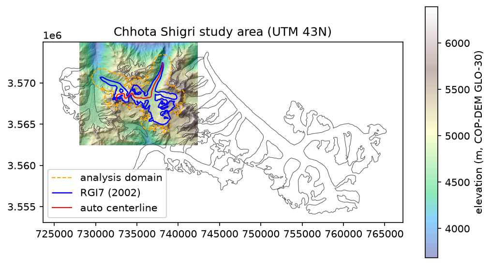
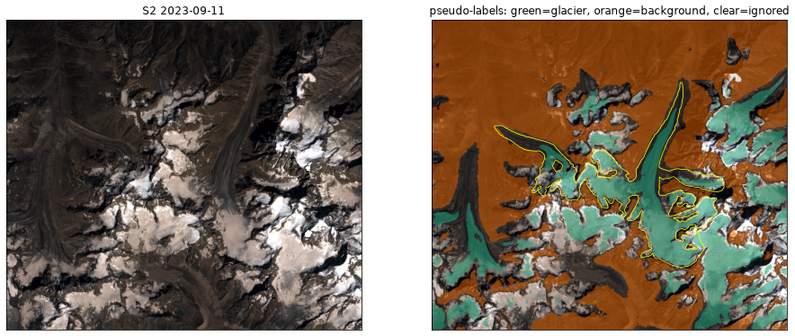
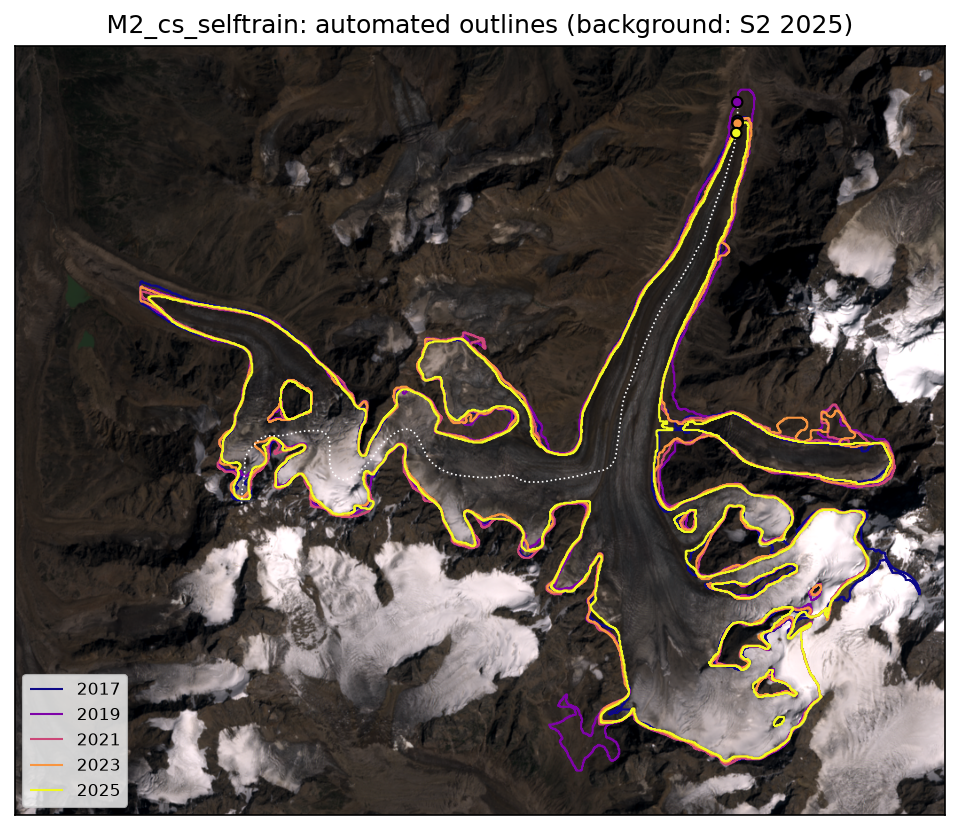
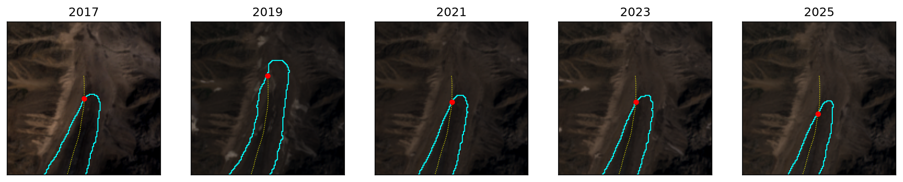
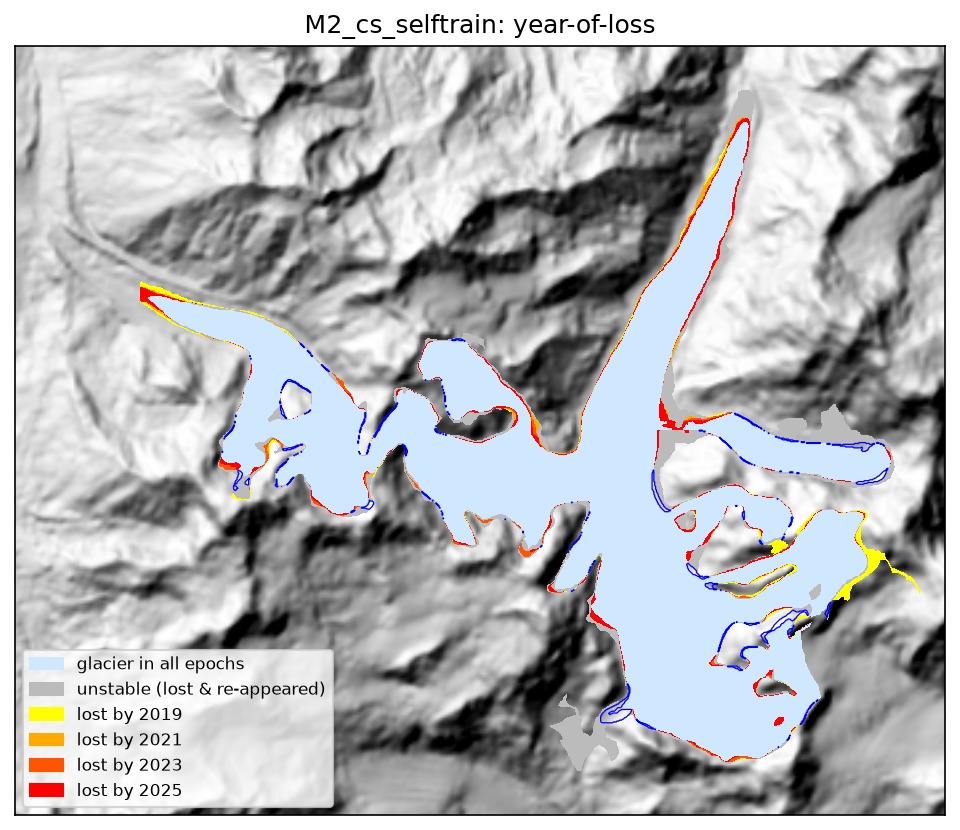
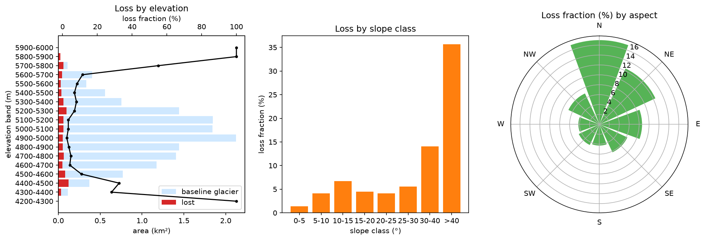
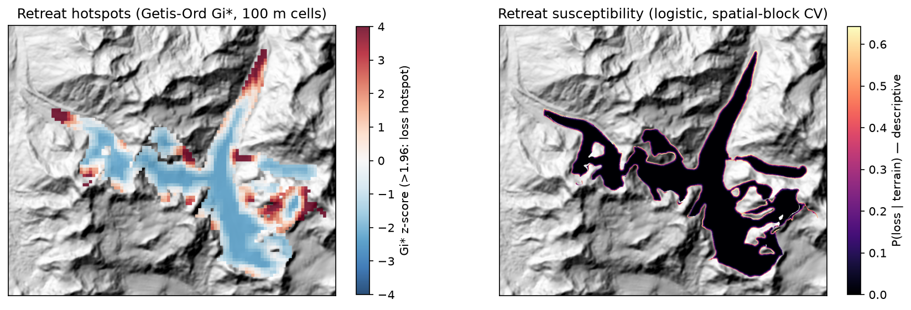

# Himalayan Glacier GeoAI — Chhota Shigri

**Automated multi-temporal glacier delineation, retreat detection and spatial pattern analysis of
Chhota Shigri Glacier (Himachal Pradesh, India) using GeoAI, Sentinel-2, Copernicus DEM,
Sentinel-1 and deep learning (GlaViTU).**

No glacier boundary, tie point or centerline in this project was drawn by hand. Every outline is
produced by a model from satellite data, and every number below comes from files in
`outputs/statistics/` and `experiments/`. The headline numbers are in
[Results](#16-results); details are in [`docs/results.md`](docs/results.md).

---

## Interactive demo

Open **`demo/index.html`** in any browser (double-click; no server needed). It shows the real
Sentinel-2 images of every analysis year with the automated boundaries:
* a year player with layer toggles (AI boundary, AI confidence, all years, 2002 RGI, terminus),
* snout close-ups,
* a 2021 vs 2025 before/after slider,
* the model comparison with benchmark accuracy,
* year-of-loss and hotspot maps.

Rebuild it from the pipeline outputs with `python -m src.visualization.demo_assets`. An offline
animation for slides is at `outputs/figures/demo_retreat_2017_2025.gif`. Fonts come from Google
Fonts when online; offline the page falls back to system fonts.

## Getting the data and weights (team setup)

Git holds the code, configs, docs, notebooks, figures, demo, vector outlines and all metric/
provenance tables (CSV/JSON: scene lists, run configs, training logs, benchmark scores). To keep
the repository small, these are **not in git**:

| Not in git | Size | How to get it |
|---|---|---|
| Sentinel-2/1 scenes, DEM, benchmark tiles (`data/…`) | ~6.5 GB | `./run_pipeline.sh` (downloads only what is needed) |
| Pretrained GlaViTU weights (`models/pretrained/*.h5`) | 3 × 40 MB | Downloaded automatically by `run_pipeline.sh` (checked against `SHA256SUMS`) |
| Trained weights: M1-local, M2, M3, ablations (`models/*/*.h5`) | 6 × 40 MB | Ask a team member for the files, or retrain (step 3 of `run_pipeline.sh`) |
| Per-scene probability rasters, masks, confidence maps | ~2 GB | Regenerated by steps 4–5 of `run_pipeline.sh` |

**Quick start for a new team member**

```bash
git clone https://github.com/r3b1e/GLOC.git && cd GLOC
mamba env create -p ./.env -f environment.yml && ./.env/bin/pip install -r requirements.txt
open demo/index.html        # results demo works immediately, no data needed
./run_pipeline.sh           # full reproduction (hours; see section 20)
```

Do not commit large rasters, `.hdf5` files or weights. The `.gitignore` already excludes them,
and GitHub rejects files over 100 MB.

## 1. Abstract

We transfer GlaViTU (Maslov et al. 2025), a convolutional-transformer glacier-mapping model, to
Chhota Shigri Glacier and use it to delineate the glacier automatically in 2017, 2019, 2021, 2023
and 2025. Five models are compared:
* M0, the global pretrained model;
* M1, fine-tuned on High Mountain Asia (HMA): the official checkpoint plus our reduced-budget
  reproduction;
* M2, adapted to Chhota Shigri by calibrated, multi-temporal pseudo-label self-training without
  any manual labels;
* M3, which adds Sentinel-1 backscatter;
* an optical-only model, for the input ablation.

On 57 held-out HMA benchmark tiles, regional fine-tuning raises pooled IoU from 0.678 (M0) to
0.748 (M1). Site self-training does not degrade HMA performance (0.779). The DEM is the most
important input (+0.149 IoU over optical-only), and SAR gave no benefit under a short
transfer-learning budget.

On Chhota Shigri, single-scene delineations vary by about 1 km² because thin snow on
debris-covered margins comes and goes between scenes. A robust multi-date ensemble reduces this
to 0.3–0.8 km² per epoch. With that precision, area change over 2017–2025 is not statistically
detectable. **Terminus retreat over 2021–2025 is detected consistently by all five models:
70–160 m, or about 20–28 m a⁻¹.** Glacier loss is concentrated within 1 km of the terminus, below
4500 m, and on steep marginal slopes.

## 2. Research problem

Can a pretrained glacier-segmentation model be transferred and fine-tuned to the Himalaya and then
delineate one glacier across years well enough to quantify retreat, without manual tracing?

Secondary questions:
1. Does HMA fine-tuning help?
2. Does site adaptation help?
3. Does the DEM help?
4. Does SAR help?
5. Can confidence-aware pseudo-labelling work?
6. Are the automated boundaries reliable enough for retreat?

## 3. Objectives

Automated acquisition, cloud screening and preprocessing → GlaViTU segmentation → automatic
post-processing and polygons → area, terminus and year-of-loss → spatial patterns and hotspots →
validation that does not rely on manual outlines → full reproducibility.

## 4. Study area

| Property | Value |
|---|---|
| Glacier | Chhota Shigri, Chandra valley, Lahaul, Himachal Pradesh |
| Inventory IDs | `RGI60-14.15990` / `RGI2000-v7.0-G-14-30579` |
| Centroid | 32.224° N, 77.508° E (the often-quoted 32.28° N 77.58° E is the Bara Shigri terminus) |
| Area | 16.77 km² (RGI 2002); published 15.5–15.7 km² |
| Elevation | 4280–5764 m (RGI); terminus ≈ 4050–4270 m |
| Grid | UTM 43N, 10 m, 1434 × 1254 px |
| Analysis domain | RGI7 + 1 km, minus 33 neighbouring glaciers (47.9 km²) |



## 5. Datasets

See [`docs/datasets.md`](docs/datasets.md).
* **Sentinel-2:** L1C TOA from the Google public bucket, discovered and screened through
  Planetary Computer (L2A).
* **Copernicus DEM GLO-30.**
* **Sentinel-1 RTC**, converted to approximate σ⁰.
* **Inventories:** RGI 6.0 / 7.0 and GLIMS (7 Chhota Shigri analyses, 11.6–16.8 km²), via the
  GLIMS WFS.
* **GlaViTU benchmark:** HMA subset, read over HTTP byte ranges from the 411 GB NIRD archive:
  165 train / 55 val / 57 test tiles.
* **Pretrained GlaViTU weights:** global, HMA fine-tuned, HMA regional.

Google Earth Engine was not used (no account). `gee/` holds untested reference ports.

## 6. Data preprocessing

[`docs/methodology.md`](docs/methodology.md) §2–3, §8.
* **Imagery:** harmonised TOA reflectance (RADIO_ADD_OFFSET), 20 m bands bilinear to 10 m, and a
  grid snapped to the 60 m Sentinel-2 lattice.
* **Clouds:** s2cloudless masks.
* **Scene sets:** all usable scenes 15 Aug–15 Sep per year (multi-date ensemble).
* **Co-registration:** phase correlation on stable terrain. Two scenes were corrected
  (0.67 px → 0.11 px, 0.36 px → 0.14 px); all residuals are ≤ 1.6 m.

## 7. Model architecture

GlaViTU: per-input fusion branches (convolution + squeeze-excitation), a SETR transformer encoder
with a deep-supervision head, a residual U-Net refinement, and a 2-class softmax. About 10 M
parameters, 384 px patches. Inputs are exactly the 8 official channels (B2, B3, B4, B8, B11, B12,
elevation, slope); M3 adds VV ascending/descending.

## 8. Transfer-learning methodology

The pretrained global model (M0) is applied as-is, the official global→HMA checkpoint is used
(M1), and the official recipe is reproduced at a reduced budget (M1-local). The recipe: Adam,
lr 5e-5 with cosine decay, focal loss on both heads, the official augmentations, label smoothing
0.1, and the checkpoint with the best HMA val IoU. The budget deviations (batch 4, 8 × 250 steps)
are recorded.

## 9. Fine-tuning methodology

Fine-tuning runs on the Apple M4 GPU through `src/training/finetune.py`, which reuses the official
data loader, samplers, augmentations and loss. A retry/resume wrapper handles intermittent
tensorflow-metal errors. All hyperparameters are in [`configs/hma_finetune.yaml`](configs/hma_finetune.yaml).

## 10. Pseudo-label / self-training methodology

* **Teacher:** M1-official. Pseudo-labels use **only the 15 even-year scenes** (2018, 2020, 2022,
  2024), so every analysis epoch is temporally held out.
* **Calibration:** the raw GlaViTU softmax never leaves about 0.24–0.89, so it is calibrated by
  isotonic regression on HMA val tiles. Held-out ECE goes from 0.239 to 0.011.
* **Label rule:**
  * glacier if calibrated P ≥ 0.95 in ≥ 60 % of clear scenes, never ≤ 0.05, and the yearly median
    is confident in ≥ 3 of 4 years;
  * background by the symmetric rule;
  * everything else is ignored (34.7 %), which includes all changing and debris margins.
* **No inventory outline is used as a label.**
* **Training:** the consensus label is applied to every scene. 40 HMA tiles are replayed, and the
  checkpoint is selected on HMA val.



## 11. Multi-temporal change detection

* **Per scene:** inference with cloud masked to NaN.
* **Per year:** per-pixel median, with robust outlier rejection of whole scenes
  (|A − median| > max(3·MAD, 0.5 km²)). Pixels with no clear core-window observation are
  gap-filled from the same year's scenes outside the window.
* **Post-processing:** threshold 0.5, median 3×3, domain clip, components connected to the
  RGI-core, small-object/hole removal, polygonise, `make_valid`.
* **Area uncertainty:** delineation buffer (½ px × perimeter), calibrated-probability threshold
  sensitivity, and between-scene surface spread.
* **Change uncertainty:** the threshold term is propagated as systematic. Trends use weighted
  least squares.
* **Year-of-loss raster:** a loss year is assigned only when the loss persists in every later
  epoch.

## 12. Terminus retreat methodology

* **Centerline:** generated automatically, as a least-cost path on the DEM inside RGI7 with cost
  1 + 200·((Dmax − D)/Dmax)⁴ (after Kienholz et al. 2014). The RGI7 centerline product needs an
  Earthdata login.
* **Measurements:** (i) the downstream-most centerline point reached continuously from the head;
  (ii) the box method, i.e. glacier area in a 2 km × 159 m tongue box divided by its width.
* **σ:** √(res² + co-registration²) per epoch.
* **Structural uncertainty:** the spread across the 5 models.

## 13. Spatial pattern analysis

Loss vs retained baseline ice by 100 m elevation band, slope class, aspect sector and distance to
the terminus, with loss fraction and enrichment. Getis-Ord Gi* hotspots on 100 m cells. An
interpretable logistic "retreat susceptibility" model with spatial-block CV. These are
descriptive, not forecasts.

## 14. Validation methodology

[`docs/validation.md`](docs/validation.md):
* **(A)** held-out HMA benchmark tiles with paired bootstrap CIs;
* **(B)** agreement with the 2002 RGI7 outline, whole glacier and upper glacier (not accuracy);
* **(C)** published areas and retreat;
* **(D)** temporal consistency (unstable pixels, significant gains/advances).

Plus probability calibration and co-registration checks. No model is validated on its own labels.

## 15. Experimental setup

Apple M4 (16 GB), macOS 26.2, Python 3.11, TensorFlow 2.15.1 + tensorflow-metal 1.1.0. Seed 42.
Official benchmark split. No HMA tile within 0.05° of the site. Run registry and incident log in
[`docs/experiments.md`](docs/experiments.md).

## 16. Results

Full tables: [`docs/results.md`](docs/results.md). Primary model: **M2** (chosen by best held-out HMA IoU).

**Held-out HMA benchmark (57 tiles).**

| Model | IoU | ΔIoU vs M0 [95 % CI] |
|---|---|---|
| M0 global | 0.678 | — |
| M1 official | 0.748 | +0.070 [0.040, 0.107] |
| M1-local | 0.758 | +0.081 [0.047, 0.125] |
| **M2** | **0.779** | +0.101 [0.064, 0.148] |

**Chhota Shigri area** (km², multi-date ensemble medians; M2 ± total σ).

| Year | 2017 | 2019 | 2021 | 2023 | 2025 |
|---|---|---|---|---|---|
| M2 | 15.00 ± 1.44 | 15.89 ± 1.41 | 15.38 ± 1.05 | 15.03 ± 1.04 | 14.30 ± 0.89 |
| cross-model range | 1.80 | 1.59 | 1.03 | 1.09 | 0.88 |

* Area trends (WLS) range from −0.02 to −0.18 km² a⁻¹ across models, and **every 95 % CI includes
  zero**: area change over 2017–2025 is not detectable at this precision.
* Published areas: 15.5–15.7 km².

**Terminus retreat.**

| Period | Box method (median [min–max], 5 models) | Centerline |
|---|---|---|
| **2021–2025** | **80 m [73–160] (≈ 20 m a⁻¹)** | **110 m [70–130] (≈ 28 m a⁻¹)** |

Every model shows retreat larger than the ≈ 10–14 m measurement error. Earlier periods are
dominated by the weak 2017/2019 epochs.

**Where loss happens (M2).**

| Factor | Loss fraction (enrichment) |
|---|---|
| Within 250 m of the terminus | 42 % (6.7×) |
| 4300–4500 m | 28–33 % (4.4–5.1×) |
| Slopes > 40° | 36 % (5.6×) |
| North-facing (aspect confounded with the tongue) | 17 % (2.7×) |
| Interior 4900–5200 m | 2–3 % (0.4–0.5×), most stable |

* Gi\* hotspots: the snout, the tip of the north-western arm, and the eastern tributary margins.
* Persistent loss 0.94 km² vs 1.74 km² of unstable (flickering) margin pixels.







## 17. Ablation studies

| Experiment | Comparison | Result (held-out tiles) |
|---|---|---|
| 1 Global pretrained | M0 | IoU 0.678 (HMA test) |
| 2 HMA fine-tuning | M1-official / M1-local vs M0 | +0.070 / +0.081, significant. M1-local ≈ M1-official (+0.011 [−0.001, 0.024]) at ≈ 1.7 % of the official steps |
| 3 Chhota Shigri adaptation | M2 vs M1-official | +0.031 [0.019, 0.046] on HMA (no forgetting; partly replay). On site: better inventory agreement (IoU 0.838 vs 0.816), boundary distance 48 m vs 61 m |
| 4 Optical vs optical + DEM | equal budgets, 22 tiles | 0.676 → 0.824, **+0.149 [0.078, 0.241]** |
| 5 + SAR | optical + DEM + VV vs optical + DEM | 0.808 vs 0.824, −0.016 [−0.029, −0.008] at a short budget |
| Sensitivity: analysis window | 15 Aug–15 Sep vs 15 Aug–15 Oct | The full window adds snowy late-season scenes. Inventory IoU drops 0.816 → 0.778, the centerline terminus breaks in 2 epochs, and a spurious −2.65 km² step appears in 2023 → 2025 |
| Calibration | raw vs isotonic | ECE 0.239 → 0.011. Raw 0.95/0.05 thresholds give 0 pseudo-labels |

## 18. Limitations

1. **Surface conditions dominate area noise.** Thin snow vs exposed debris on the margins changes
   single-scene area by about 1 km², and the ensemble reduces but does not remove this. Area
   change over 2017–2025 (expected ≈ 0.25 km² from the long-term ≈ 0.03 km² a⁻¹) is below the
   detection limit.
2. **Debris-covered snout and margins.** Terminus *position* differs by up to ~800 m between
   models, so only *changes* (with cross-model spread) are reported. Debris cover reportedly
   tripled in 2005–2014.
3. **2017 and 2019 are weak epochs.** There are only 2 core-window scenes each (2017 was mostly
   Sentinel-2A only), about 3 km² of the domain has a single clear look, and the 2017 baseline
   needed a 0.67 px co-registration correction.
4. **Seasonal timing.** Both 2025 scenes are from August, while 2023 includes September; part of
   the 2023→2025 step may be seasonal.
5. **Reduced training budgets.** M1-local used about 1.7 % of the official steps, and M2, M3 and
   the ablations used 800–1000 steps. In particular the SAR result reflects a short budget.
6. **Approximate SAR on Chhota Shigri.** Sentinel-1 RTC γ⁰ is converted to σ⁰ by γ⁰·cos θ only,
   which leaves terrain-area flattening differences from the benchmark σ⁰.
7. **Post-hoc analysis window.** The 15 Aug–15 Sep window was chosen after diagnostics. The full
   window is reported as a sensitivity run.
8. **No independent, contemporaneous reference outline** exists for 2017–2025. Site accuracy is
   inferred from HMA benchmark performance, inventory agreement in stable zones, and temporal
   consistency.
9. **M2's gain on HMA** also reflects extra HMA replay training. It shows no forgetting, but it
   is not proof of site benefit.
10. **Hardware.** Apple Metal instability forced CPU inference and resumable training. Calibration
    for M0/M1-local/M2/M3 used 10 val tiles (M1-official used 20).

## 19. Future work

* Full-budget fine-tuning (80 epochs) and SAR + InSAR coherence with properly processed σ⁰ (SNAP
  or GEE), aimed at the debris margins.
* Add Landsat (1990s–2016) for a long baseline where change exceeds the noise.
* Monthly or seasonal masks to model and remove seasonal snow effects.
* Debris-specific labels from thermal or velocity data.
* An expert-traced validation subset (outside the core pipeline) to quantify site accuracy.
* The official RGI7 centerlines (Earthdata).
* Iterative self-training rounds.

## 20. Reproducibility instructions

```bash
# environment (Apple Silicon tested; Linux/NVIDIA: install tensorflow==2.15.1 without -metal)
mamba env create -p ./.env -f environment.yml
./.env/bin/pip install -r requirements.txt        # exact versions: requirements.lock.txt
# full pipeline (downloads ~45 GB over HTTP, stores ~7 GB; several hours on an M4)
./run_pipeline.sh
```

* Every step reads `configs/chhota_shigri.yaml`, `configs/global.yaml` and
  `configs/hma_finetune.yaml`.
* Scene IDs: `data/sentinel2/ensemble_<year>.{csv,json}` and `scenes/<date>/scene.json`.
* Training runs: `experiments/<M>/<run>/run_config.json` + `training_log.csv`.
* Weights: `models/` (SHA-256 for the pretrained ones).
* Notebooks `notebooks/01–07` display every stage from the saved outputs.

### Repository layout

```
configs/        chhota_shigri.yaml, global.yaml, hma_finetune.yaml
src/data/       inventory, dem, sentinel2 (screening, s2cloudless, L1C), sentinel1, benchmark (HTTP ranges)
src/preprocessing/ coregister (phase correlation, sub-pixel correction)
src/inference/  glavitu (official-equivalent inference, weight transfer), ensemble (multi-date), run
src/postprocessing/ mask (threshold, components, polygonise, topology)
src/training/   finetune (official recipe, resumable), pseudo_labels (calibrated, multi-temporal)
src/change_detection/ centerline, change (area, terminus, year-of-loss), patterns (hotspots, susceptibility)
src/validation/ metrics, benchmark_eval, calibration, site_validation, aggregate_results
src/visualization/ maps, plots
notebooks/      01–07 (thin front-ends over saved outputs)
gee/            NOT RUN Earth Engine reference ports
docs/           methodology, datasets, experiments, validation, results
outputs/        masks, polygons, confidence, change_maps, figures, statistics
experiments/    per-model per-year rasters/summaries, training logs, benchmark evaluations
```

### Citation of the core model

Maslov, K. A., Persello, C., Schellenberger, T., Stein, A. (2025). Globally scalable glacier
mapping by deep learning matches expert delineation accuracy. *Nature Communications* 16, 43.
https://doi.org/10.1038/s41467-024-54956-x. Code GPL-2.0, so this repository is GPL-2.0.
